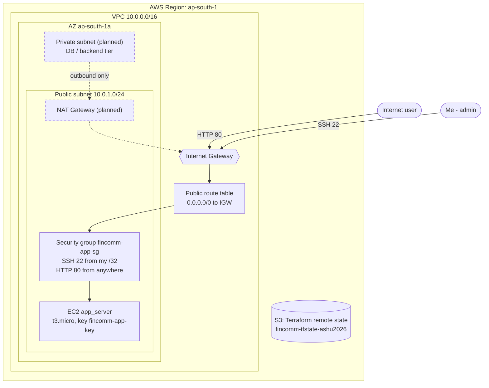
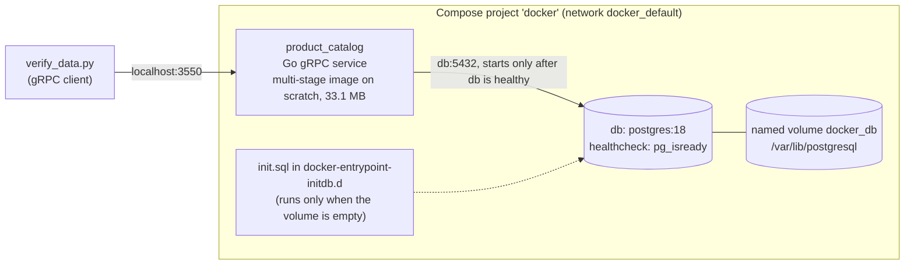

# FinComm Architecture (v1)

AWS diagram: solid = deployed via Terraform, dashed = planned (see `docs/adr/20260830-ADR_nat-gateway.md`). The container stack further down runs locally.

## Container stack (local, Docker Compose)

This runs on my laptop, not on AWS yet. One command (`docker compose up -d --wait`) creates the network, the volume and both containers.

| Piece | Why it is built this way |
|---|---|
| Multi-stage build on `scratch` | Compile in a large Go image, ship only the static binary: 1.35 GB -> 33.1 MB |
| Service name `db` as the host | Compose gives each service a DNS name on its network; no IP addresses in config |
| Named volume | Database data survives container removal; `down -v` deletes it on purpose |
| `healthcheck` + `depends_on: service_healthy` | "Started" is not "ready": the app waits until Postgres accepts connections (see `docs/scratch-logs/sl-004.md`) |
| No host port on `db` | The app reaches it over the Compose network; host port 5432 is already used by a native Postgres |

Open items: push the image to a registry (ECR), build it in CI, then Kubernetes.

## Terraform mapping
| Diagram box | Resource | File |
|---|---|---|
| VPC | `aws_vpc.main` | `terraform/vpc_foundations/main.tf` |
| Public subnet | `aws_subnet.public` | same |
| Internet Gateway | `aws_internet_gateway.main` | same |
| Route table + association | `aws_route_table.public`, `aws_route_table_association.public` | same |
| Security group + rules | `aws_security_group.app_sg` + ingress/egress rules | `security_groups.tf` |
| EC2 | module `ec2-instances` | `terraform/ec2_app/` |
| Remote state | S3 backend; EC2 project reads VPC outputs via `terraform_remote_state` | both projects |

## Two-project flow
`vpc_foundations` applies first and exports `public_subnet_id` and `app_sg_id`. `ec2_app` reads those outputs and launches the EC2 instance into that subnet and SG.
